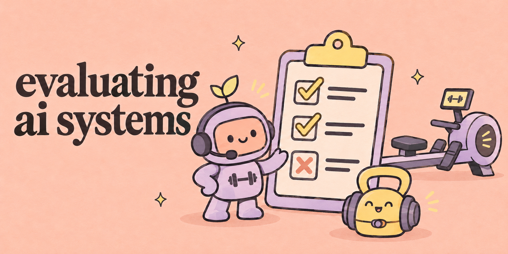
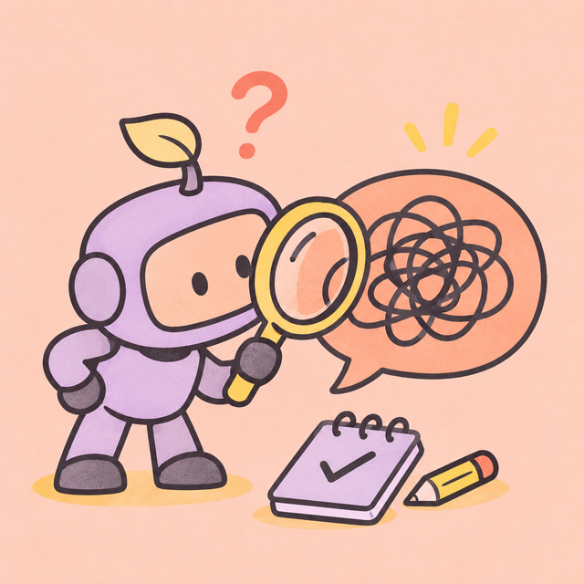

<p align="center">
  
</p>

# Evaluating AI Systems

The companion repo for my AI evals course. Everything from the video is here, with exercises so you can follow along and make it stick.

**📺 Watch the course on YouTube:** coming soon

## ✅ What you'll do



You'll take one app, a customer support bot, from "it seems fine when I try it" to a set of evals you can trust.

- 🔍 Read the bot's real answers and find how it fails
- 📝 Write a rubric and turn it into an eval suite
- 🧩 Check retrieval, groundedness, and tool calls one piece at a time
- ⚖️ Build an LLM judge and check it against human labels
- 🚦 Evaluate agents, then set up sampling and CI gates for production

Most exercises don't need an API key, and every notebook runs in Google Colab.

<br clear="right">

## 🏋️ Meet BeefCake Fitness

<p align="center">
  
</p>

The running example is the support bot for **BeefCake Fitness**, a made-up home-gym company. We wrote the manuals, FAQ, and policies ourselves, so it's easy to tell when the bot makes something up.

BeefCake sells four products:

| Product | What it is |
|---|---|
| BeefCake Row | Smart rowing machine with a screen |
| BeefCake Bell | App-connected adjustable kettlebell |
| BeefCake Pulse | Heart-rate chest strap |
| BeefCake Coach | Subscription app with classes |

## 🚀 Getting started

### Option 1: Google Colab (easiest)

Open any notebook in `notebooks/` in Colab. The first cell downloads the repo and installs what it needs.

To add an API key, click the key icon in Colab's left sidebar, add a secret named `OPENAI_API_KEY`,
`ANTHROPIC_API_KEY`, or `GEMINI_API_KEY`, and switch on notebook access.

### Option 2: your laptop

You need Python 3.10 or newer.

```bash
git clone https://github.com/MarinaWyss/evaluating-ai-systems.git
cd evaluating-ai-systems
python3 -m venv .venv
source .venv/bin/activate
pip install -r requirements.txt
cp .env.example .env
.venv/bin/jupyter notebook notebooks/
```

After `cp .env.example .env`, open `.env` and paste in one API key. If you use [uv](https://docs.astral.sh/uv/),
you can replace the venv and install steps with `uv venv && source .venv/bin/activate` and
`uv pip install -r requirements.txt`.

Launching Jupyter as `.venv/bin/jupyter` matters: it guarantees the notebooks run on the environment you just
installed into, even if you have other Pythons (pyenv, conda, Homebrew) on your machine. If you open the
notebooks in VS Code or Cursor instead, click the kernel picker in the top right and choose the interpreter at
`.venv/bin/python` inside this repo. If a notebook ever reports `No module named 'pandas'`, the kernel is not
the `.venv` — the setup cell will tell you how to fix it.

### No API key?

Most of the course works without one. The traces you'll analyze are pre-generated, and cells that need a live
model tell you so and skip themselves. Two exercises are different:

- **Exercise 0:** without a key, you see what the bot retrieves instead of its answer.
- **Exercise 8:** running your own judge (steps 2 to 4) needs a key. Without one, you see a recorded run of our judge.

A key also lets you generate your own traces and try the stretch goals.

### Choosing a model

The bot uses [LiteLLM](https://docs.litellm.ai/), so any major provider works. It picks a default model for
whichever key it finds, and judges default to a stronger model from the same provider. To choose models yourself,
set `BEEFCAKE_MODEL` (and `BEEFCAKE_JUDGE_MODEL` for judges) in `.env` using LiteLLM's `provider/model` names, for
example `openai/gpt-6-luna`. If you set only `BEEFCAKE_MODEL`, judges use it too. Providers retire models, so
if a call fails with a "model not found" error, set `BEEFCAKE_MODEL` to a current one.

## 📓 The notebooks

| Notebook | Module | What you do |
|---|---|---|
| `00_setup_check.ipynb` | Opening, Exercise 0 | Chat with the bot and check your setup |
| `02_error_analysis.ipynb` | Module 2, Exercises 2 and 3 | Read traces, write open codes, group them into failure modes |
| `03a_rubric_agreement.ipynb` | Module 3, Exercise 4a | Write a rubric, label traces (ideally with a second person), measure agreement |
| `03b_eval_suite.ipynb` | Module 3, Exercise 4b | Build the eval spreadsheet, a reference-based eval, and code checks |
| `04_component_evals.ipynb` | Module 4, Exercises 5, 6, and 7 | Blame game, retrieval metrics, groundedness, tool-call checks |
| `05_llm_judge.ipynb` | Module 5, Exercises 8 and 9 | Build a judge, align it on dev, test it once, correct a pass rate, swap test |
| `06_agents_production.ipynb` | Module 6, Exercise 10 | Multi-agent autopsy, handoff assertions, agent metrics, a production log, CI gates |

Module 1, Module 7, and Exercises 1, 11, and 12 have no notebook. Exercises 1, 11, and 12 are about your own app,
and Module 7 works from the v1.0 and v1.1 traces you already met in `03b_eval_suite.ipynb`.

## 🤖 The three versions of the bot

| Version | Used in | What it is |
|---|---|---|
| v1 (`bot.py`) | Opening to Module 3 | A RAG bot: retrieve chunks from the docs, then answer |
| v2 (`agents.answer_v2`) | Module 4 | One agent with tools: `search_docs`, `lookup_order`, `start_return`, `check_warranty`, `create_ticket` (the handoff to a person). There's deliberately no refund tool, and `start_return` doesn't check the 30-day return window, so the agent has to look the order up first |
| v3 (`agents.answer_v3`) | Module 6 | A router hands each question to a Device Support agent or an Orders and Billing agent |

The tools act on a small fake store (`store.py`) with five orders and four devices, reset before every run. Its
"today" is fixed at October 5, 2026, so return windows and warranties behave the same every time.

## 🗂️ What's in the repo

```
beefcake/        the bot and the eval helpers
  bot.py           version 1: a RAG bot (retrieve chunks, then answer)
  retrieval.py     BM25 keyword search over the docs
  classifier.py    which product is the customer asking about?
  traces.py        save, load, and print traces
  evals.py         failure rates, Wilson intervals, McNemar's test, Cohen's kappa, code checks
  agents.py        versions 2 and 3: the agent loop, the router, and agent traces made of spans
  tools.py         tool schemas, and running tool calls against the store
  store.py         the fake store: orders, returns, warranties, tickets
  checks.py        reusable code checks, agent metrics, and CI gates
  judge.py         LLM judges, TPR and TNR, the Rogan-Gladen correction, the swap test, groundedness
  retrieval_metrics.py  hit rate, recall, precision, MRR, nDCG
  phoenix_export.py     optional: send traces to Arize Phoenix
  llm.py           one small wrapper around LiteLLM
docs/            the product manuals, policies, and FAQ the bot answers from
data/            test questions, traces, and exercise files
rubric/          the rubric template, with a worked example
scripts/         generate live traces; rebuild the data and notebooks
tests/           checks that the materials still match the video
answer_keys/     maintainers only (see below)
```

## 🧾 About the traces

The questions and the retrieval are real: the History column in every trace is exactly what the v1 bot
sends to the model. The answers in the pre-generated traces are written by hand, so everyone
sees the same planted failures as the video. Those traces are marked `curated` in the Source column.

To see what your own model does with the same questions:

```bash
python scripts/generate_traces.py                 # saves data/my_traces_v1.0.csv
python scripts/generate_traces.py --prompt v1.1   # the prompt with the policy fix
```

Your live traces will fail in different ways from the curated ones. That's a good exercise in itself: code
them the same way and compare.

The agent traces for Modules 4 and 6 work the same way. The tool calls are planned by hand, but they run through
the real agent loop and the real tools, so every tool result and end state is real. The Exercise 8 traces are
built from templates and labeled with the "Assumes device" rubric. The production log in Module 6 is synthetic.

To explore agent traces span by span in [Arize Phoenix](https://github.com/Arize-ai/phoenix), install it in a
separate virtual environment (it can pull in a newer OpenAI SDK than LiteLLM supports), start it, and send traces to it:

```bash
pip install arize-phoenix && phoenix serve
```

Then open http://localhost:6006. Back in this repo's environment:

```bash
pip install arize-phoenix-otel
python scripts/phoenix_demo.py
```

Pass `--live` to `phoenix_demo.py` to run v3 on a few questions first.

## 🛠️ For maintainers

- **Answer keys** live in `answer_keys/`, which is gitignored so it never reaches the public repo.
- **The notebooks** are generated: edit `scripts/build_notebooks.py`, then run `python scripts/build_notebooks.py`.
- **If you change the docs or the curated answers,** run `python scripts/build_curated_data.py`, then
  `python -m pytest -q`. The tests check that retrieval and the failure counts still match the video.
  That script is gitignored like `answer_keys/`, because it contains the Exercise 4a labels.
  For Modules 4 to 6, the same goes for `scripts/build_agent_data.py`, which writes the Exercise 5, 6, 7, and
  10 answer keys.
- **Phoenix:** run `python scripts/phoenix_demo.py` without `--live` and open trace M2, the trace shown in
  Module 6. Live runs take different paths.
- **Record the judge runs once,** with a key: `python scripts/record_example_runs.py`, then commit
  `data/example_runs/`. The Module 5 notebook shows that run to anyone without a key, and the swap-test result
  in Module 5 comes from it.
- **Evals in CI:** `python scripts/run_ci_evals.py` exits with an error when a gate fails. On the stored traces
  it fails on purpose, to show that a 90% suite threshold can pass while individual checks fail.
